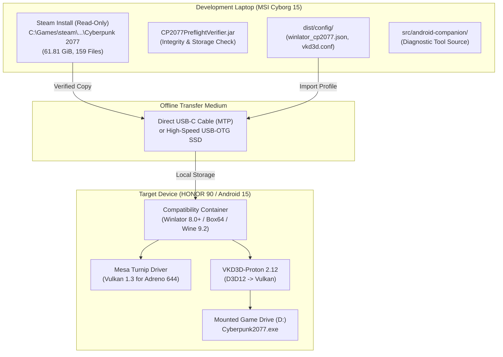

# DEPLOYMENT PLAN — Cyberpunk 2077 on Android (HONOR 90)

- **Date:** 2026-10-27
- **Workspace:** `C:\CP2077-Android-Engineering`
- **Scope:** Controlled staging and offline deployment of project-owned tools, configurations, and legally owned game data.

---

## 1. Deployment Architecture

---

## 2. Deployment Phases

### Phase A: Laptop Pre-Deployment Validation (CURRENT STATE: COMPLETE)
- Verify local game integrity using `CP2077PreflightVerifier.jar`.
- Ensure all 159 files are present and match recorded checksums.
- Confirm flagged anomaly `cyberpunk2077_addresses.json` remains sealed and excluded from transfer.
- Assemble verified deployment bundle in `dist/`.

### Phase B: Phone Hardware & Storage Preparation (PENDING USER ACTION)
- Target phone storage capacity audit:
  - Required: $\ge 75\text{ GB}$ free space.
  - Current: $\approx 18\text{ GiB}$ free space.
  - Action: User must free storage or provide an external USB-C SSD.
- Install Winlator 8.0+ APK on the phone from verified official source (`github.com/brunodev85/winlator/releases`).

### Phase C: Controlled Data Transfer (PENDING APPROVAL)
- Transfer game files via USB-C MTP:
  - Destination: `/storage/emulated/0/Cyberpunk2077` (or `/storage/XXXX-XXXX/Cyberpunk2077` on OTG drive).
  - Verify transferred file count (158 files, excluding anomaly).
- Transfer runtime configuration:
  - Place `winlator_cp2077.json` in phone downloads.
  - Import container settings into Winlator.

### Phase D: First Launch & Validation
- Start Winlator container.
- Launch `Cyberpunk2077.exe` with low-memory arguments:
  `-qualityLevel=Low -skipStartScreen -launcher-skip`
- Observe Denuvo anti-tamper response and VKD3D-Proton shader compile behavior.

---

## 3. Rollback Procedure

- **Phone rollback:** Simply delete the `Cyberpunk2077` folder and uninstall Winlator. This instantly reclaims all storage without touching system partitions.
- **Laptop rollback:** No rollback required. The laptop Steam installation was strictly read-only and never modified.
